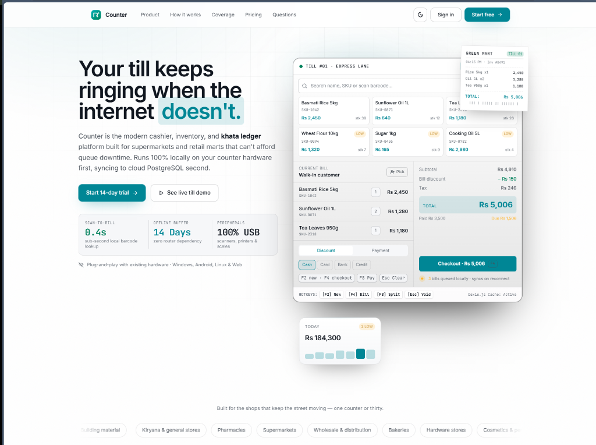

# Counter — Modern Offline-First Retail Mart & POS Platform

> *"Your till keeps ringing when the internet doesn't."*

**Counter** is a keyboard-first, offline-ready point of sale (POS), inventory, and customer khata management platform built for modern supermarkets, grocery marts, pharmacies, and high-volume retail stores.

Counter is engineered with an offline-first architecture to provide reliable, uninterrupted checkout operations. By leveraging local in-browser database storage (`Dexie.js` over `IndexedDB`), cashiers can scan barcodes, ring up sales, and generate receipts smoothly without depending on constant internet connectivity. Once a connection is active, sales records and inventory adjustments automatically sync with the cloud database (Supabase).

🔗 **Live Website / Demo:** [counterhere.netlify.app](https://counterhere.netlify.app/)

---

> **Notice:** This repository is a commercial product showcase and portfolio case study. The application source code, proprietary synchronization logic, and database schemas remain private. For live demonstration access or licensing, please contact directly below.

---

## 📸 Product Overview & Interface

A modern, distraction-free retail cashier experience running locally on counter hardware. Featuring instant barcode search, itemized grocery lines, split cash/credit tenders, real-time Khata ledger tracking, and thermal paper receipt printing:

---

## ⚡ Core Capabilities

| Feature | Description | Benefit |
|---|---|---|
| **Fast Local Checkout** | In-browser IndexedDB caching | Responsive barcode lookups and immediate line itemization. |
| **Offline Billing Continuity** | Local transaction queue | Cash registers continue billing and printing receipts during network drops. |
| **Full Numpad Operation** | Custom keyboard navigation layer | Cashiers process baskets quickly without needing a mouse. |
| **Digital WhatsApp Receipts** | Direct API dispatch & downloadable slip | Reduces paper usage while making receipts easy for customers to save. |
| **Dual-Entry Khata Ledger** | Built-in debit/credit ledger | Clear credit tracking for recurring customer accounts. |
| **Multi-Branch Cloud Sync** | Timestamp reconciliation | Centralized sales and stock visibility across store locations. |
| **Hardware Agnostic** | Standard WebUSB, WebSerial & ESC/POS | Compatible with standard USB barcode scanners and thermal receipt printers. |

---

## 🛠️ Tech Stack

- **Frontend:** React 19, TypeScript, Vite
- **Styling:** Tailwind CSS, Scoped OKLCH Tokens, Lucide Icons
- **Local Persistence:** Dexie.js (IndexedDB wrapper)
- **Cloud Backend:** Supabase (PostgreSQL, Row-Level Security, Edge Functions)
- **Hardware Protocol:** WebUSB API, WebSerial API, ESC/POS binary encoding

---

## 💬 Access, Demos & Commercial Inquiries

Counter is available for commercial deployment, customized mart setups, or private enterprise pilots.

- **WhatsApp:** [+92 317 0319398](https://wa.me/923170319398)
- **Email:** [dastageerb44@gmail.com](mailto:dastageerb44@gmail.com)

---

*Built by Ghulam Dastageer — Full-Stack Developer.*
